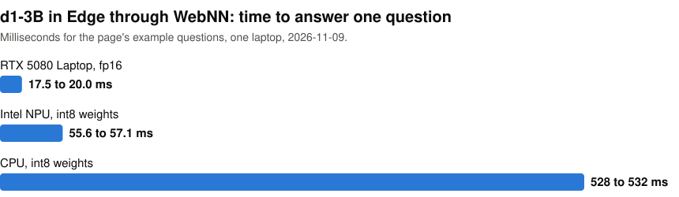

# d1-3B through Windows ML and WebNN on a Windows laptop

[LiquidAI/d1-3B](https://huggingface.co/LiquidAI/d1-3B) answers questions about some text by giving each option a probability, without generating any text. I ran it through Windows ML and through WebNN in Edge and Chrome, and both worked. This repo has the results and a web page you can build and open in Edge to ask your own questions.

<picture>
  <source media="(prefers-color-scheme: dark)" srcset="https://raw.githubusercontent.com/john-rocky/d1-windows-ml-webnn/main/docs/images/page-time-dark.svg">
  
</picture>

For example, I gave the page the text "I was charged twice this month, please refund one of them." and asked "Which team should handle this?" with the options billing, technical and fraud. In Edge on the RTX it returned 0.98, 0.01 and 0.01 in 18 to 20 ms.

Of my 415 test questions, 311 fit the page's limit of 128 tokens. I compared the page's top answer on those with the model's reference code. All 311 matched on the RTX and the NPU, and 310 on the CPU.

## Build and open the page

[`web/demo.html`](web/demo.html) runs in Edge on Windows. You type some text, your questions and their options, pick the GPU, the NPU or the CPU, and press Decide. On this laptop the GPU choice used the RTX. The page shows each option's probability and how long the decision took. Getting a device ready took 21 to 85 s. After a pause, the first decision on the GPU took 0.18 to 0.2 s, or 1.0 s in the app window.

You build the model files first, with [these PowerShell blocks](docs/run-it.md) in order, and the page runs from your own machine. [The block on the demo page](docs/demo-page.md) then copies its files, starts a local server and opens it. I only ran them on the laptop below. You need:

- Windows 11 x64, Python 3.12, git and Edge
- about 42 GB of free disk
- 32 GB of memory with the page file on, and nothing else heavy running
- a folder with [LiquidAI/d1-3B](https://huggingface.co/LiquidAI/d1-3B) from Hugging Face

## Windows ML against ONNX Runtime from PyPI

With the same model files and the OpenVINO execution provider on both sides, Windows ML took 0 to 11 % longer than ONNX Runtime from PyPI on the Intel GPU, the NPU and the CPU. The PyPI side is my [d1-on-windows](https://github.com/john-rocky/d1-on-windows) setup on the same laptop.

On the RTX, the Windows ML build of ONNX Runtime GenAI (`onnxruntime-genai-winml` 0.19.0) has no CUDA support, so it ran on WebGPU. With a 101-token prompt, that took 117 ms in fp32, against 21.7 ms for CUDA in fp16.

## Documentation

- [All results](docs/results.md), including WebNN in Edge and Chrome
- [The demo page in detail](docs/demo-page.md)
- [What did not work](docs/what-did-not-work.md), with the error messages

## The machine

MSI Stealth 16 AI+, Windows 11 Home 25H2, Core Ultra 9 386H, 32 GB of memory, RTX 5080 Laptop 16 GB, Intel Graphics and an Intel NPU. Driver versions are in [the results](docs/results.md).

## License

The code here is under the MIT license. The model weights are not in this repo. d1-3B itself is under the [LFM Open License v1.0](https://huggingface.co/LiquidAI/d1-3B/blob/main/LICENSE).
